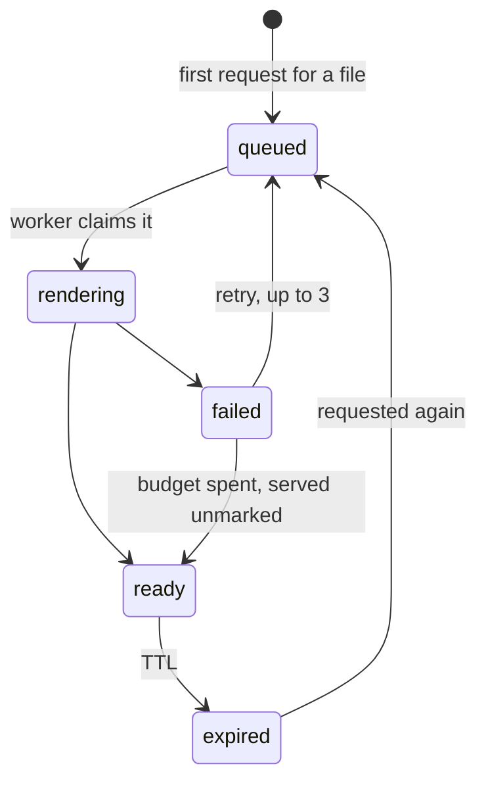
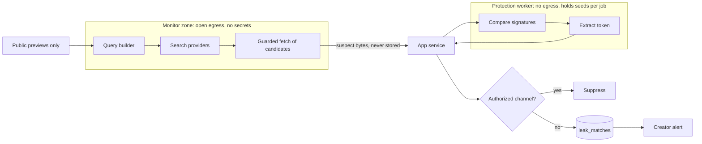
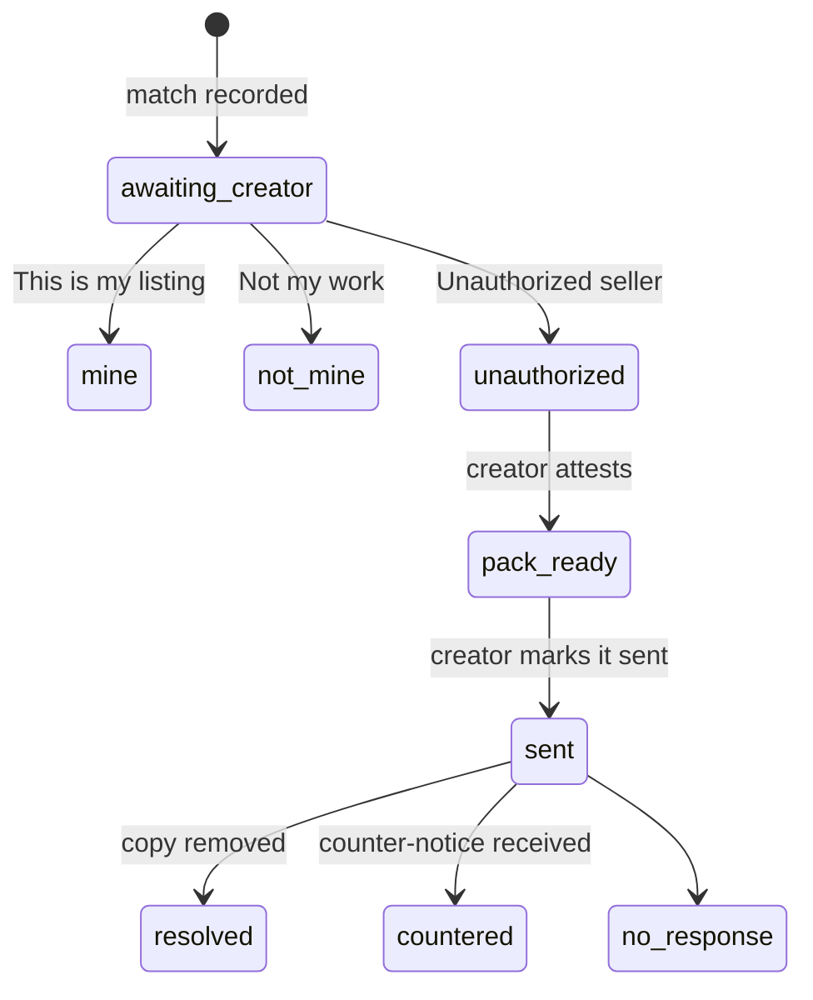

# Anti-Piracy Engine: Fingerprinting, Leak Detection & Takedowns

> **Proposed design. Nothing here is built, and it binds nothing until the rulings in §13 are
> made.** Logged as Decision #393. It depends on
> [`ASSET_DELIVERY_ARCHITECTURE.md`](ASSET_DELIVERY_ARCHITECTURE.md), which defines entitlements,
> deliveries and the public and protected planes. Business rules: `PRODUCT_SPEC.md` §Digital
> Marketplace & IP Governance 7. Plan numbers: `finance-model.md` §16.8.
>
> ⚖️ marks anything that needs counsel. The statutory summaries here are engineering notes for
> designing the workflow. They are not legal advice.

## 1. Assessment and threat model

**Fingerprinting deters and traces. It does not prevent.** A determined buyer can degrade a
fingerprint, and a generative model can redraw a picture from its preview. The value of this engine
is that casual redistribution becomes attributable, and that a creator can find and contest public
resale without paying someone to do it.

| Adversary                        | Goal                         | Control                                             | Residual risk                                                     |
| :------------------------------- | :--------------------------- | :-------------------------------------------------- | :---------------------------------------------------------------- |
| Stranger                         | Get the original             | Private storage, derivative previews                | Low: they get only the preview                                    |
| Buyer who re-shares              | Redistribute a paid copy     | Per-buyer fingerprint, recorded delivery            | Medium: a copy can be attacked                                    |
| Two or more colluding buyers     | Diff copies to find the mark | Key-dependent, repeated embedding                   | Medium: collusion-resistant codes are not in this version         |
| Reseller on a public marketplace | Sell a copy                  | Leak monitoring, takedown pack                      | Depends on what can be reached (§7.2)                             |
| Generative model                 | Clone or inpaint a preview   | Overlays, cropping, source formats (§9)             | **High, and rising**                                              |
| False claimant                   | Take down a rival            | Creator attestation, IP eligibility, match evidence | Medium: statements are sworn, but the platform cannot judge title |

## 2. The transaction fingerprint

The brief asks for `BuyerID + TransactionID + Timestamp`. The design delivers exactly those three
facts by embedding **an opaque 64-bit token that resolves to them**, and never the values
themselves.

```text
token  = 64 random bits, unique per file (catalogue.deliveries.fingerprint_token)
lookup = (file_id, token) → delivery → entitlement → order line → buyer, order, timestamp
embed  = token + error-correcting code + sync pattern, spread under the seller's key
```

Three reasons for the indirection (ruling B1):

- **Capacity.** Two uuids alone are 256 bits before a timestamp or error correction. Published
  robust image schemes carry on the order of 50 to 100 bits. Literal values do not fit.
- **Erasure.** A buyer's id burnt into bytes on strangers' disks can never be erased. A token is
  meaningless once its row is unlinked, so the retention rules in §12 stay achievable.
- **Forgery.** Plain ids can be written into a file to frame someone. A token is unguessable, and it
  decodes only under the seller's key.

The token is stable: one per entitlement and file, so a re-render reproduces the same mark.

## 3. Embedding by format

### 3.1 Methods

Images, textures and audio use **frequency-domain embedding**, the method the brief asks for. The
token is written into transform coefficients (wavelet and DCT for pictures) and not into individual
samples, so it survives the re-encoding that would erase a pixel-level mark. Formats with no
perceptual tolerance use the container methods at the foot of the table.

Robustness below is a **target for the self-test** (§5), not a promise.

| Kind                                    | Method                                                           | Target survival                                              | Does not survive            |
| :-------------------------------------- | :--------------------------------------------------------------- | :----------------------------------------------------------- | :-------------------------- |
| Raster images, textures                 | DWT + DCT on luma, perceptually masked, repeated across tiles    | JPEG re-compression, downscaling to 50%, crops, colour edits | Regeneration, repainting    |
| Audio                                   | Spread spectrum in masked bands                                  | Lossy codecs at common bitrates, loudness normalisation      | Re-performance              |
| Video                                   | A/B segments: two pre-encoded variants, stitched per buyer       | Re-encoding, screen capture of a full work                   | Clips shorter than the code |
| 3D with textures                        | The raster method on albedo maps                                 | Texture re-compression                                       | Re-texturing                |
| 3D mesh, optional                       | Low-amplitude vertex displacement                                | Mild decimation                                              | Retopology                  |
| PDF, documents                          | Margin stamp plus XMP, not frequency-domain (delivery spec §9.2) | Casual sharing                                               | Retyping                    |
| Fonts                                   | Licence fields in the `name` table                               | Casual sharing                                               | Any font editor             |
| Code, presets, archives, layered source | Per-buyer container hash and signed licence file                 | Exact copies                                                 | Any edit                    |

**Layered source (PSD, AI, BLEND, stems) gets no content mark in this version.** A per-layer mark
needs a writer that preserves blend modes, smart objects and non-destructive edits exactly, and a
corrupted source file is worse for a seller than an unmarked one. This matters: §9 argues source
formats are where value should move, and they are also the least traceable. Sellers must be told so.

**A per-buyer file changes its hash.** The buyer's SHA-256 differs from the seller's, so integrity
is checked against the delivery row and not against `files.items`.

### 3.2 Extreme assets

"Zero perceptual loss" and "zero numerical loss" are different promises. Any mark changes sample
values, so only the first is reachable. If the numbers are the product, the honest answer is
`disabled`.

| Asset                            | Default                 | Controls                                                                                                                                                                                  |
| :------------------------------- | :---------------------- | :---------------------------------------------------------------------------------------------------------------------------------------------------------------------------------------- |
| Gigapixel artwork                | `subtle`, `tile-dwt-v1` | Streams 4096 px tiles in bounded memory. The token repeats per tile, so any sizeable crop decodes it. Exclusion regions protect microscopic sub-scenes. Band and strength are adjustable. |
| Astronomical (16/32-bit, linear) | `disabled`              | Pixel values are measurements, so marking corrupts data. A seller selling only a stretched render may opt in on that render.                                                              |
| Medical, scientific scans        | `disabled`              | The same reasoning. Delivery is recorded and hashed, so an exact copy is still provable.                                                                                                  |
| CAD                              | `disabled`              | Geometry is the product, and a vertex offset is a dimensional error.                                                                                                                      |

The whitelist in the delivery spec §8.3 does not yet admit FITS or DICOM. Add them only with these
defaults, and see §12 on patient data.

## 4. Creator controls

### 4.1 Modes

Numbers are starting gates, tuned by the self-test and adjustable as `security.platform_params`
dials.

| Mode       | Intent                                                                                              | Image gate                               | Default for                     |
| :--------- | :-------------------------------------------------------------------------------------------------- | :--------------------------------------- | :------------------------------ |
| `heavy`    | Maximum tamper resistance. Artefacts may be visible in flat areas at 100%.                          | PSNR ≥ 38 dB                             | Opt-in                          |
| `subtle`   | Imperceptible to the human eye, with lower robustness.                                              | PSNR ≥ 48 dB · SSIM ≥ 0.995 · ΔE2000 ≤ 1 | Every markable format           |
| `disabled` | No marking. Delivery is still recorded and hashed, so an exact copy can be proven and nothing else. | Identical bytes                          | CAD, scientific, layered source |

`disabled` costs traceability, not detection: monitoring still finds copies by perceptual signature.
The seller is told that at the moment of choosing.

### 4.2 Parameters

Sellers tune **vetted algorithms inside bounds**. They do not upload code, because a seller-supplied
algorithm would run on the platform's worker against other people's purchases.

- **Algorithm:** a closed registry: `dwt-dct-v1`, `tile-dwt-v1`, `audio-ss-v1`, `video-ab-v1`,
  `mesh-offset-v1`. A new id is added by a deliberate change, and none is ever removed, because old
  copies must still decode.
- **Seed:** generated by the platform with 256 random bits by default. A seller may regenerate it or
  supply their own value, which is mixed with a platform secret through HKDF, so a weak phrase
  cannot weaken anything. It is stored through the existing envelope (EPI §9.4) and never returned
  to any client. The interface shows only a revision number.
- **Why a seed matters to a seller.** It moves the noise pattern, which can lift energy off a
  sensitive structure. It is a tuning knob for extreme assets, not an extra security layer.
- **Exclusion regions:** rectangles in source pixels that receive no embedding.
- **Revisions:** any change writes a new revision and affects only future renders. Earlier revisions
  are kept, or their copies could never be traced.

### 4.3 Configuration schema

```ts
export const ProtectionMode = z.enum(["heavy", "subtle", "disabled"]);

export const WatermarkAlgorithm = z.enum([
	"dwt-dct-v1",
	"tile-dwt-v1",
	"audio-ss-v1",
	"video-ab-v1",
	"mesh-offset-v1",
]);

const ExclusionRegion = z.object({
	x: z.number().int().nonnegative(),
	y: z.number().int().nonnegative(),
	width: z.number().int().positive(),
	height: z.number().int().positive(),
});

const FileProtection = z.object({
	fileId: z.string().uuid(),
	mode: ProtectionMode,
	algorithm: WatermarkAlgorithm.optional(), // omitted: the default for the file's category
	strength: z.number().min(0).max(1).optional(), // bounded per mode by the service
	exclusions: z.array(ExclusionRegion).max(32).default([]),
});

/** A product's protection, as the seller edits it. Seeds never appear here. */
export const ProtectionSettingsSchema = z.object({
	mode: ProtectionMode, // the product default
	files: z.array(FileProtection).max(24).default([]), // one override per manifest entry
	preview: z.object({
		overlay: z.enum(["none", "light", "dense"]),
		maxLongEdgePx: z.number().int().min(320).max(4096).optional(),
		sampleSeconds: z.number().int().min(5).max(60).optional(),
		samplePages: z.array(z.number().int().positive()).max(20).optional(),
	}),
});
```

```json
{
	"mode": "subtle",
	"files": [
		{
			"fileId": "XXXX-XXXX",
			"mode": "subtle",
			"algorithm": "tile-dwt-v1",
			"strength": 0.2,
			"exclusions": [{ "x": 41200, "y": 18800, "width": 2048, "height": 2048 }]
		}
	],
	"preview": { "overlay": "dense", "maxLongEdgePx": 1600 }
}
```

## 5. Preview and diff verification

A seller of an extreme asset must not take this on trust. Before a configuration goes live they see
what it does to their own file.

**Address.** It is a section of the listing workspace, so the state is linkable:
`/catalogue/:slug?tab=edit&section=protection&file={fileId}&view=diff&tile={x},{y}`, and the same
under `/teams/:teamHandle/catalogue/:slug`.

| Step | What happens                                                                                                                                                             |
| :--- | :----------------------------------------------------------------------------------------------------------------------------------------------------------------------- |
| 1    | The seller chooses a mode and parameters.                                                                                                                                |
| 2    | The worker renders samples at 100%, using a throwaway token: regions the seller picks, plus the worst cases it finds itself (flat gradients, fine detail, deep shadows). |
| 3    | The viewer compares original and marked, in four views: side by side, swipe, a manual A/B toggle, and an amplified difference heat map.                                  |
| 4    | Metrics appear beside each sample, against the mode's gate (below).                                                                                                      |
| 5    | **Self-test:** the sample goes through JPEG at quality 75, a 50% downscale and a 10% crop, and the result is reported: "the mark survives 3 of 3".                       |
| 6    | The seller confirms. `confirmed_at` is stored, the revision goes live, and later renders use it.                                                                         |

| Media | Metrics                                                                      |
| :---- | :--------------------------------------------------------------------------- |
| Image | PSNR · SSIM · ΔE2000, whole file and worst tile                              |
| Audio | Null-test residual in dBFS, plus a spectrogram difference                    |
| Video | PSNR and SSIM per segment                                                    |
| 3D    | Hausdorff distance as a percentage of the bounding box, and normal deviation |

**Rules.**

- Sample bytes are derived from an original, so they are served only to the owner, through the
  protected plane with `entitled-preview` headers, and they expire with the run.
- **A toggle, never auto-flicker.** The A/B view changes only on input, which respects reduced
  motion and avoids a flashing surface.
- Swipe is a real `role="slider"`, operable by keyboard.
- Reuse the inspector's embedded canvases (`useInspectorHost(…, { embedded: true })`) for pan and
  zoom. A new component goes on the `DESIGN_SYSTEM.md` §C.1 roster in the same change.

**Publishing.** Default profiles need no confirmation, so an ordinary seller is never held up. A
changed configuration needs one.

## 6. Render lifecycle



- **Rendered on first request, not at purchase,** so an unused purchase costs nothing.
- **`catalogue.deliveries` is the queue.** Rows are claimed with `FOR UPDATE SKIP LOCKED`, an
  immediate kick starts them, and an `ops.scheduled_jobs` tick recovers anything stranded, so no new
  queue technology is needed.
- **Expected wait.** Below about 50 MiB the buyer should wait seconds. Larger files show "Preparing
  your download", and a notification arrives when ready. This changes the "instant delivery" wording
  (ruling A9 in the delivery spec).
- **Failure policy (ruling B4).** After three attempts or 15 minutes, the original is served with
  `delivered_unmarked = true`, and the seller is told. The buyer has paid. Non-delivery is a
  refundable failure and a dispute, which costs the seller more than one unmarked copy.
- **`disabled` skips the queue** and streams from `originals`.

### 6.1 Protection worker

It is a new container set on the safety node's private network, separate from `safety-api` so a long
render can never starve moderation. It keeps Zone D's rules (EPI §2): one inbound identity, no
volumes beyond tmpfs, no storage credentials, and no egress.

The app streams the bytes and the unwrapped seed for one job, and the worker returns the result and
keeps nothing. The contract lands in `Projective-Safety/contract/openapi.yaml`:

| Route                     | Input                                                | Output                      |
| :------------------------ | :--------------------------------------------------- | :-------------------------- |
| `POST /protect/embed`     | File stream, token, algorithm, parameters, seed      | Marked file stream, metrics |
| `POST /protect/extract`   | Suspect stream, reference signature, seed, algorithm | Token or none, confidence   |
| `POST /protect/derive`    | File stream, preview recipe                          | Preview derivatives         |
| `POST /protect/signature` | File stream                                          | Signatures (§7.3)           |

**Cost must be measured before launch:** CPU seconds per GiB, egress per sale and retained
`deliveries` bytes, set against a commission as low as 6.5% of a low-priced product. Those numbers
decide whether small products render at all.

## 7. Leak detection

### 7.1 Entitlement

Automated monitoring is restricted to premium seller plans (`finance-model.md` §16.8). Private
storage, fingerprinting, creator controls and recorded delivery are available to every seller, in
keeping with the rule that no tier should feel suffocating (§16). A downgrade pauses monitoring and
loses nothing already found.

### 7.2 Scope and disclaimer

This text is shown wherever monitoring is sold or configured, and in the seller's terms. ⚖️

> **Leak monitoring is best-effort.** We search as far as we can reach across public web indices. We
> cannot find every copy, and we cannot see private groups, closed networks, paid communities, the
> deep web or anything behind a login. A clear result does not mean your work has not been copied.
> Matches can be wrong, so every one needs your review, and nothing is ever sent without you.

Coverage differs by format, and the interface must say so per product:

| Kind      | Reach    | Why                                                                    |
| :-------- | :------- | :--------------------------------------------------------------------- |
| Images    | Best     | Reverse image search exists                                            |
| Documents | Moderate | Web search on distinctive text                                         |
| Code      | Moderate | Public code search on distinctive tokens                               |
| Video     | Weak     | Key frames through image search only                                   |
| 3D        | Weak     | Only the thumbnails on asset sites                                     |
| Audio     | Weak     | No general public index; a commercial fingerprint service would be new |

### 7.3 Signatures

Computed once at publish by the protection worker, from the original, so nothing about a private
file reaches a third party.

| Kind       | Signature                                        | Used for                                 |
| :--------- | :----------------------------------------------- | :--------------------------------------- |
| Every file | SHA-256 of the original and of each delivery     | Exact-copy proof                         |
| Image      | 64-bit pHash for the whole image and a tile grid | Near-duplicates, crops                   |
| Image      | CLIP embedding, self-hosted                      | Candidate ranking, heavily edited copies |
| Audio      | Chromaprint-style acoustic fingerprint           | Matching a fetched sample                |
| Video      | pHash sequence over key frames                   | Matching a fetched sample                |
| 3D         | pHash over rendered views                        | Matching thumbnails                      |
| Document   | Page pHash and a text simhash                    | Matching a fetched sample                |
| Code       | Winnowed token hashes                            | Matching a repository                    |

CLIP is self-hosted, not Voyage: `voyage-4` is a text model, and a CLIP model baked into the worker
image follows the same rule as the safety node's other models.

### 7.4 Pipeline



- **Monitor zone.** The safety node denies all egress except `database.clamav.net` (EPI §2.2), so a
  crawler cannot live there. It runs apart, holding no seeds, no originals and no storage
  credentials.
- **Inputs are public previews only.** Query providers are third parties, and private content never
  leaves (EPI §3.5). A low-resolution preview is sufficient, because perceptual matching is
  scale-tolerant.
- **Providers.** Google Cloud Vision Web Detection returns full matches, partial matches and pages
  with matching images. TinEye and first-party marketplace search are candidates. Choose at build,
  and check each provider's terms and pricing then.
- **Fetching.** Every candidate URL goes through the guarded socket rules of `link-fetch.ts`,
  because it is a host chosen by a stranger. The monitor honours `robots.txt` and never logs in,
  bypasses a paywall or solves a challenge.
- **Suspect bytes are untrusted and never stored.** They are scored in memory and dropped. The
  record keeps the URL, hashes, scores and capture time.
- **Allowlist before alert.** Authorized channels are filtered out first, so a creator's own store
  does not alert them every week.

### 7.5 Match tiers

Thresholds are dials, starting here.

| Tier      | Evidence                                  | Takedown pack                                                             |
| :-------- | :---------------------------------------- | :------------------------------------------------------------------------ |
| `exact`   | SHA-256 equals the original or a delivery | Offered                                                                   |
| `traced`  | Token decoded after error correction      | Offered, with a licence check first (§8.1)                                |
| `strong`  | pHash Hamming distance ≤ 10 of 64         | Offered                                                                   |
| `similar` | CLIP cosine ≥ 0.92 only                   | **Not offered** unless the creator states that it is a copy of their file |

`similar` carries a warning, because a similar style is not a copy, and a notice sent on style alone
is the misrepresentation §8.3 warns about.

## 8. Creator workflow and takedowns

Sales on Projective are **non-exclusive**: a creator may sell the same independent asset elsewhere.
So a match is a question, not a finding, and **the engine never issues a takedown**. There is
deliberately no outbound notice door in the system.

### 8.1 The alert

Each match opens at `/catalogue/protection?match=lkm-…`, and the seller gets a notification.

> **Is this your listing or an unauthorized seller?** {source thumbnail} · {host} · found {date} ·
> {tier in words}
>
> `This is my listing` · `Unauthorized seller` · `Not my work`

| Answer              | Effect                                                                                                             |
| :------------------ | :----------------------------------------------------------------------------------------------------------------- |
| This is my listing  | Adds an `authorized_channels` row (host, optional path) and suppresses future matches there. Editable in settings. |
| Unauthorized seller | Moves to the takedown pack (§8.3).                                                                                 |
| Not my work         | Dismisses it and suppresses that URL.                                                                              |

**A `traced` match gets a licence check first.** A buyer with a `commercial` or `extended` licence
may be using the file exactly as permitted, for instance in a client's advert. The alert says so
before it offers a pack.

### 8.2 Lifecycle



These are domain states (`PRODUCT_MANAGEMENT.md` §3.5), not build-tracker states. Nothing is
hard-deleted: closed rows take `archived_at`.

### 8.3 The takedown pack

"One click" generates a pack after the creator has validated the match. It does not send anything.
The creator sends it, signed by them, and Projective is neither the sender nor their agent (ruling
B6). That keeps `PRODUCT_SPEC.md` §Digital Marketplace 4 true: the platform is the system of record,
not an arbiter of off-platform activity.

The pack maps onto the six elements of 17 U.S.C. § 512(c)(3)(A): ⚖️

| Element                                    | Source                                                       |
| :----------------------------------------- | :----------------------------------------------------------- |
| (i) Signature of the authorised person     | The creator signs. Never pre-filled.                         |
| (ii) The work                              | Listing title and address, first-published date, provenance  |
| (iii) The infringing material and location | Matched URLs, capture time, hashes, tier                     |
| (iv) Contact information                   | The creator's own, entered for this notice                   |
| (v) Good-faith statement                   | Explicit statement, ticked by the creator                    |
| (vi) Accuracy and authority statement      | Explicit statement, under penalty of perjury as to authority |

**Before generating,** the creator must acknowledge two things, which are recorded with a timestamp:

- They considered fair use. _Lenz v. Universal_ (9th Cir. 2015) requires this consideration before a
  notice is sent.
- A knowing material misrepresentation creates liability under § 512(f).

The pack also includes the IP Audit Trail evidence (`PRODUCT_SPEC.md` §Digital Marketplace 4) and a
suggested abuse contact for the host. It never includes a buyer's identity, or a copy of the
infringing file.

**"DMCA" is a US process.** The pack should be labelled a takedown notice, with a jurisdiction
variant: an EU host expects a Digital Services Act notice, and elsewhere the host's own form
applies. Counsel confirms the templates before launch. ⚖️

### 8.4 Who may claim

| Provenance (`PRODUCT_SPEC.md` §Digital Marketplace 1 to 3) | Who may confirm and generate                                                               |
| :--------------------------------------------------------- | :----------------------------------------------------------------------------------------- |
| Independent listing                                        | The creator, as 100% owner                                                                 |
| Project-derived, Shared Ownership                          | The listing seller. The client co-owner is notified, and their consent need depends on B7. |
| Project-derived, Client-only                               | Nobody here. It cannot be listed, and the rights are the client's.                         |
| Team-owned                                                 | A team member with authority over the listing                                              |

The "Request to Sell" workflow is not built, so today's provenance is the seller's own declaration.
Repeatedly false attestations go to Trust & Safety.

### 8.5 When a copy traces to a buyer

- **The creator sees only** "This copy traces to a licensed purchase made in {month year}". Never a
  name or an account (ruling B3).
- **A fingerprint shows which delivery leaked, not who leaked it.** Accounts are compromised, and a
  buyer's client or contractor may have held the file. So there is **no automatic penalty** (ruling
  B5). An operator reviews it, and any action goes through `security.penalties`.
- **Identity leaves the platform only through legal process.** ⚖️

## 9. AI inpainting and scraping resistance

**Assume previews will be cleaned, and design so that the clean result is still not the product.**
Preprints from 2025 and 2026 report diffusion regeneration driving decode rates for robust marks
such as StegaStamp and TrustMark close to chance while keeping image quality high (for example
[arXiv 2602.20680](https://arxiv.org/abs/2602.20680) and
[arXiv 2510.05978](https://arxiv.org/html/2510.05978v1); preliminary, so verify before relying on
the figures). Dekel et al. (CVPR 2017) showed that a visible mark repeated identically across a
collection can be estimated and removed automatically. The controls below are ranked by how long
they will last.

| # | Control | Design | Durability | | : | :------------------------------- |
:---------------------------------------------------------------------------------------------------------------------------------------------------------------------------
| :--------- | | 1 | **Value shift to source** | Sell what regeneration cannot produce: PSD, AI,
BLEND, stems, parametric models. | High | | 2 | **Withheld resolution** | The preview simply lacks
the detail. A model must invent it, and invention is not the product. | High | | 3 | **Strategic
crop and occlusion** | Hide what is hardest to infer. | Medium | | 4 | **Micro-pattern overlay** |
Baked in, randomised per image. | Low to medium | | 5 | **Adversarial perturbation** | Optional and
tool-specific. | Low |

### 9.1 Overlays

- **Baked into the derivative, never a CSS layer.** A CSS layer is deleted in DevTools in seconds,
  and the bytes underneath would be clean.
- **Randomised per image:** position, rotation, spacing and opacity all come from a per-listing
  seed, which defeats removal by estimating a shared pattern.
- **High coverage across the subject,** with fine lines crossing the structures a model needs. A
  corner logo is cropped in one step.
- **Versioned.** A new overlay version re-cuts derivatives under new paths, so the immutable CDN
  rule still holds and overlays can keep pace with new models.
- **Measured.** An overlay can reduce conversion, so `dense` is an opt-in, and the default `light`
  is compared against none through `analytics.events` before any change.

### 9.2 Cropping and occlusion

Each category has a preview recipe, chosen in the seller's Protection section:

- **Templates, UI kits:** real screens at reduced scale, with key sections cropped.
- **Textures:** a tile fragment, too small to repeat seamlessly.
- **3D:** fixed orbit angles, no wireframe, no UV view.
- **Audio:** an excerpt, never the full arrangement or isolated stems.

**A preview must fairly represent the product.** A crop can withhold detail but must never hide a
defect or misstate what is sold: "a product is bought sight-unseen" (`catalogue.products.specs`),
and misdescription leads to refunds and consumer-law exposure. ⚖️ Cropping stays inside the showcase
band (`PRODUCT_SPEC.md` §The showcase band).

### 9.3 The value shift

This needs no schema. `file_manifest` already names extensions, and the `specs` ledger already
prints seller-declared facts such as `14 layers` or `Stems: 12`. The change is guidance: the
catalogue workspace prompts for source files, and the view page's existing manifest shows them. Any
ranking weight for source formats is a separate decision, against the rules in `finance-model.md`
§16.7.

### 9.4 Scraping

- **Rate limits and bot rules** at the CDN on the public plane.
- **A machine-readable rights reservation:** an EU text-and-data-mining opt-out through
  `tdm-reservation` (TDMRep, a W3C community report and not a W3C standard), and `robots.txt`
  entries for AI crawlers. ⚖️ These are honoured voluntarily, and they create a record rather than a
  barrier.
- **Listing pages stay indexable.** Search traffic is how products sell, so nothing here may hide
  the public front.

## 10. Data model (proposed, not migrated)

Same rule as the delivery spec §10: edited in place, and absent from `documentation/database/*`
until migrated.

```sql
-- 00000004_enums_domains.sql
CREATE TYPE catalogue.protection_mode AS ENUM ('heavy', 'subtle', 'disabled');
CREATE TYPE marketplace.match_tier AS ENUM ('exact', 'traced', 'strong', 'similar');
CREATE TYPE marketplace.leak_match_status AS ENUM (
    'awaiting_creator', 'mine', 'not_mine', 'unauthorized'
);
CREATE TYPE marketplace.takedown_status AS ENUM (
    'pack_ready', 'sent', 'resolved', 'countered', 'no_response'
);

-- 00000023_tables_catalogue.sql
CREATE TABLE catalogue.protection_profiles (
    product_id uuid PRIMARY KEY REFERENCES catalogue.products (id) ON DELETE CASCADE,
    revision integer NOT NULL DEFAULT 1 CHECK (revision > 0),
    settings jsonb NOT NULL,  -- ProtectionSettingsSchema
    confirmed_at timestamptz,
    confirmed_by uuid,
    updated_at timestamptz NOT NULL DEFAULT now()
);

-- Kept for ever per revision: an old copy can only be traced with its own key.
CREATE TABLE catalogue.protection_keys (
    product_id uuid NOT NULL REFERENCES catalogue.products (id) ON DELETE CASCADE,
    revision integer NOT NULL,
    seed_ciphertext bytea NOT NULL,  -- the ENCRYPTION_KEY envelope (EPI §9.4)
    settings jsonb NOT NULL,         -- the snapshot embedded under this revision
    created_at timestamptz NOT NULL DEFAULT now(),
    PRIMARY KEY (product_id, revision)
);

-- 00000014_tables_marketplace.sql
CREATE TABLE marketplace.asset_signatures (
    id uuid PRIMARY KEY DEFAULT gen_random_uuid(),
    file_id uuid NOT NULL REFERENCES files.items (id) ON DELETE CASCADE,
    kind text NOT NULL CHECK (kind IN ('sha256', 'phash', 'clip', 'acoustic', 'simhash', 'winnow')),
    tile integer NOT NULL DEFAULT 0 CHECK (tile >= 0),
    hash bytea,
    embedding vector(512),  -- CLIP only
    created_at timestamptz NOT NULL DEFAULT now(),
    CONSTRAINT asset_signatures_key UNIQUE (file_id, kind, tile),
    CONSTRAINT ck_asset_signatures_value CHECK (hash IS NOT NULL OR embedding IS NOT NULL)
);

CREATE TABLE marketplace.authorized_channels (
    id uuid PRIMARY KEY DEFAULT gen_random_uuid(),
    owner_type files.owner_kind NOT NULL,
    owner_id uuid NOT NULL,
    product_id uuid REFERENCES catalogue.products (id) ON DELETE CASCADE,  -- NULL: all products
    host text NOT NULL,
    path_prefix text NOT NULL DEFAULT ''::text,
    created_by uuid NOT NULL,
    created_at timestamptz NOT NULL DEFAULT now(),
    archived_at timestamptz
);

CREATE TABLE marketplace.leak_matches (
    id uuid PRIMARY KEY DEFAULT gen_random_uuid(),
    slug text NOT NULL UNIQUE,  -- `lkm-…` (Decision #88)
    product_id uuid NOT NULL REFERENCES catalogue.products (id) ON DELETE CASCADE,
    file_id uuid NOT NULL REFERENCES files.items (id) ON DELETE CASCADE,
    source_url text NOT NULL,
    host text NOT NULL,
    tier marketplace.match_tier NOT NULL,
    scores jsonb NOT NULL DEFAULT '{}'::jsonb,
    status marketplace.leak_match_status NOT NULL DEFAULT 'awaiting_creator',
    first_seen_at timestamptz NOT NULL DEFAULT now(),
    last_seen_at timestamptz NOT NULL DEFAULT now(),
    decided_by uuid,
    decided_at timestamptz,
    archived_at timestamptz,
    CONSTRAINT leak_matches_source_key UNIQUE (file_id, source_url),
    CONSTRAINT ck_leak_matches_decided CHECK (
        status = 'awaiting_creator' OR (decided_by IS NOT NULL AND decided_at IS NOT NULL)
    )
);

-- Separate, with no client policy: a creator must never reach the buyer through their own match.
CREATE TABLE marketplace.leak_traces (
    match_id uuid PRIMARY KEY REFERENCES marketplace.leak_matches (id) ON DELETE CASCADE,
    delivery_id uuid NOT NULL REFERENCES catalogue.deliveries (id)
);

-- A case cannot exist without the creator: both NOT NULLs are the "never automatic" rule.
CREATE TABLE marketplace.takedown_cases (
    id uuid PRIMARY KEY DEFAULT gen_random_uuid(),
    slug text NOT NULL UNIQUE,  -- `tkd-…` (Decision #88)
    match_id uuid NOT NULL UNIQUE REFERENCES marketplace.leak_matches (id),
    confirmed_by uuid NOT NULL,
    statements_accepted_at timestamptz NOT NULL,
    jurisdiction text NOT NULL DEFAULT 'us' CHECK (jurisdiction IN ('us', 'eu', 'other')),
    status marketplace.takedown_status NOT NULL DEFAULT 'pack_ready',
    pack_file_id uuid REFERENCES files.items (id) ON DELETE SET NULL,
    sent_at timestamptz,
    resolved_at timestamptz,
    archived_at timestamptz,
    created_at timestamptz NOT NULL DEFAULT now()
);

-- 00004012_indexes_catalogue_marketplace.sql
CREATE INDEX ix_leak_matches_inbox ON marketplace.leak_matches (product_id, status, last_seen_at DESC);
CREATE INDEX ix_authorized_channels_host ON marketplace.authorized_channels (owner_id, host)
    WHERE archived_at IS NULL;
```

| Table                 | Client access                                                                                                             |
| :-------------------- | :------------------------------------------------------------------------------------------------------------------------ |
| `protection_profiles` | Owner read. Writes go through a definer that bumps the revision.                                                          |
| `protection_keys`     | **None.** No policy, reached only by the service.                                                                         |
| `asset_signatures`    | **None.**                                                                                                                 |
| `authorized_channels` | Owner read. Writes through a service.                                                                                     |
| `leak_matches`        | Owner read. A verdict is one definer door.                                                                                |
| `leak_traces`         | **None.**                                                                                                                 |
| `takedown_cases`      | Owner read. A definer creates them, refusing a non-owner, an ineligible IP status or a `similar` match with no statement. |

## 11. API contracts

All routes are thin, over `ProtectionBackendService` in `@server/services/protection/*`, with
schemas in `@projective/types/protection`. Every `/api/catalogue/*` route takes `?team=` as
elsewhere.

| Route                                              | Methods         | Contract                                                                                                    |
| :------------------------------------------------- | :-------------- | :---------------------------------------------------------------------------------------------------------- |
| `/api/catalogue/protection`                        | `GET` · `PUT`   | `?id=<listing>`. `PUT` takes `ProtectionSettingsSchema` and answers the new revision. Never carries a seed. |
| `/api/catalogue/protection/seed`                   | `POST`          | `{ source: "regenerate" } \| { source: "seller", value }`. Answers the revision only.                       |
| `/api/catalogue/protection/preview`                | `POST` · `GET`  | Start a run, read it with `?run=`. §5 metrics and sample addresses.                                         |
| `/api/catalogue/protection/preview/[run]/[sample]` | `GET`           | Sample bytes, owner only, `entitled-preview` headers.                                                       |
| `/api/catalogue/protection/confirm`                | `POST`          | `{ id, revision }`. Stamps `confirmed_at`.                                                                  |
| `/api/protection/matches`                          | `GET`           | `?status=&tier=&product=`. Keyset-paged. Plan-gated.                                                        |
| `/api/protection/matches/[match]/verdict`          | `POST`          | `{ verdict: "mine" \| "unauthorized" \| "not_mine" }`.                                                      |
| `/api/protection/channels`                         | `GET` · `POST`  | The allowlist.                                                                                              |
| `/api/protection/channels/[id]`                    | `DELETE`        | Archives the row. Matches at that host can alert again.                                                     |
| `/api/protection/takedowns`                        | `POST`          | `{ match, jurisdiction, statements }`. `422` without every statement.                                       |
| `/api/protection/takedowns/[case]`                 | `GET` · `PATCH` | The case, and the creator's own `sent` / `resolved` / `countered` marks.                                    |
| `/api/protection/takedowns/[case]/pack`            | `GET`           | The pack as a PDF. `delivery` headers.                                                                      |
| `/api/protection/cron/[job]`                       | `POST`          | The `/api/*/cron/*` bearer pattern, from `ops.scheduled_jobs`: scans, stranded renders, sweeps.             |

```ts
export const ProtectionBackendService: {
	render(deliveryId: string): Promise<ServiceResult<DeliveryOutcome>>;
	startPreview(
		actor: ReadActor,
		listing: string,
		settings: ProtectionSettings,
	): Promise<ServiceResult<{ run: string }>>;
	recordVerdict(
		actor: ReadActor,
		match: string,
		verdict: MatchVerdict,
	): Promise<ServiceResult<LeakMatch>>;
	openTakedown(actor: ReadActor, input: TakedownInput): Promise<ServiceResult<TakedownCase>>;
};
```

**Plan gate.** A monitoring route without the entitlement refuses with `PK402`, the existing family,
which the console answers with an upgrade notice. Reads of past matches stay open after a downgrade.

**Dev Context Switcher (root `CLAUDE.md` §5).** Same change as the build: `pj.dev.watermark` (`auto`
· `ready` · `failed-unmarked`), `pj.dev.leak` (`auto` · `none` · `exact` · `traced` · `similar`),
and the plan gate through the existing plan override.

## 12. Privacy, retention and legal

| Subject                     | Rule                                                                                                                                                                                                                       |
| :-------------------------- | :------------------------------------------------------------------------------------------------------------------------------------------------------------------------------------------------------------------------- |
| Disclosure ⚖️               | Buyers are told before payment that files carry a traceable mark, and the licence forbids removing it. Sellers' and buyers' terms and the privacy notice change together. A data protection impact assessment is likely.   |
| Token retention             | A `deliveries` row lives with its order line (the ledger class, `finance-model.md` §17). When that ends, the row is unlinked and every copy's token resolves to nothing, with no change to any file.                       |
| Leak records                | Matches: 12 months after closing. A takedown case: the 6-year dispute class. Both are proposals for the §17 table.                                                                                                         |
| Suspect content             | Never stored. Only URLs, hashes, scores and times.                                                                                                                                                                         |
| Health and research data ⚖️ | A DICOM or scan listing can carry patient identifiers in its metadata. Sellers must attest that a file is de-identified, and the platform does not verify this. Counsel decides whether these listings are allowed at all. |
| **Inbound notices** ⚖️      | See below.                                                                                                                                                                                                                 |

### The gap the brief does not mention

This spec covers Projective helping creators pursue others. Projective is also a host. A marketplace
that sells user uploads will receive notices against its own listings, and `apps/web/features/legal`
contains nothing about copyright or takedowns today.

US safe harbour under § 512 requires, among other things, a designated agent registered with the
Copyright Office and published on the service (§ 512(c)(2)), a repeat-infringer policy that is
adopted and reasonably implemented (§ 512(i)), and a counter-notice process that restores material
10 to 14 business days after a valid counter-notice (§ 512(g)). The EU equivalent is the Digital
Services Act's notice-and-action duty. **This must exist before the marketplace opens, regardless of
this engine** (ruling B8).

## 13. Rulings needed

Logged in Decision #393, alongside A1 to A11 in the delivery spec. The recommendation is what this
document assumes.

| #   | Question                                                                                   | Recommendation                                                                                                                | Who      |
| :-- | :----------------------------------------------------------------------------------------- | :---------------------------------------------------------------------------------------------------------------------------- | :------- |
| B1  | Embed literal `BuyerID + TransactionID + Timestamp`, or an opaque token resolving to them? | The token. Literal values do not fit, cannot be erased and can be forged (§2).                                                | Owner ⚖️ |
| B2  | Which plans are "premium seller plans"? None has that name.                                | Pro, Pro Team and Agency. No new plan and no add-on (`finance-model.md` §16.8). Business Pro and Enterprise are buyer plans.  | Owner    |
| B3  | May a creator learn a traced buyer's identity?                                             | No. Operators only, or through legal process.                                                                                 | Owner ⚖️ |
| B4  | If rendering fails, is the buyer served unmarked or held?                                  | Served unmarked after 15 minutes. The seller is told.                                                                         | Owner    |
| B5  | Is there any automatic penalty for a traced buyer?                                         | None. A human reviews.                                                                                                        | Owner    |
| B6  | Who sends a notice?                                                                        | The creator. Projective neither sends nor acts as agent. An agent service would be a separate legal product.                  | Owner ⚖️ |
| B7  | Must a client co-owner consent to a takedown on a Shared Ownership asset?                  | Notify, without consent, unless the deed requires it. Client-only assets cannot be listed.                                    | Owner ⚖️ |
| B8  | Who builds the inbound notice process, and when?                                           | A separate track, finished before the marketplace opens.                                                                      | Owner ⚖️ |
| B9  | Can a seller without monitoring still report a copy they found themselves?                 | Recommended, though the brief did not ask: a pasted URL enters the same flow, costs no crawl, and honours "never suffocated". | Owner    |
| B10 | Accept a monitor zone with open egress, and the search providers?                          | Yes. Adds a row to the provider register (EPI §1.1).                                                                          | Owner    |

## 14. Verification

| Check                            | Proof                                                                                                                                               |
| :------------------------------- | :-------------------------------------------------------------------------------------------------------------------------------------------------- |
| Bytes unchanged when disabled    | A `disabled` delivery's SHA-256 equals the original's.                                                                                              |
| Round trip                       | Per algorithm, fixture files embed, attack (§5), extract, and return the right token. A wrong seed returns none.                                    |
| Perceptual gates                 | `subtle` meets §4.1 on a fixture set including gradients and 16-bit images.                                                                         |
| Stable tokens                    | A re-render after TTL produces the same token.                                                                                                      |
| Old revisions decode             | A copy from revision 1 extracts after the seed is regenerated.                                                                                      |
| No client path to keys or buyers | A probe proves `authenticated` reads nothing from `protection_keys`, `asset_signatures`, `leak_traces` or `deliveries`, using `SET ROLE` in `psql`. |
| **Never automatic**              | A probe proves `takedown_cases` refuses a row with no `confirmed_by`, and a search of the service finds no outbound notice call.                    |
| Allowlist                        | A match on an authorized host creates no alert.                                                                                                     |
| Plan gate                        | Free refuses with `PK402`. A downgrade pauses scans and keeps past matches readable.                                                                |
| Failure policy                   | A worker outage serves the original, sets `delivered_unmarked`, and notifies the seller.                                                            |
| Disclaimer                       | The §7.2 text renders on every surface that sells or configures monitoring.                                                                         |

**Not specified here:** collusion-resistant codes, per-layer marks for source formats, an acoustic
fingerprint service, and a Projective-run takedown agency. Each would be its own decision.

## Sources

External facts were checked on 2026-11-06. Re-check them at build, because these pages change.

- [17 U.S.C. § 512](https://www.law.cornell.edu/uscode/text/17/512): notice elements, designated
  agent, counter-notice timing, repeat infringers, misrepresentation.
- [_Lenz v. Universal Music Corp._ (9th Cir. 2015)](https://cdn.ca9.uscourts.gov/datastore/opinions/2015/09/14/13-16106.pdf).
- [Google Cloud Vision: Web Detection](https://docs.cloud.google.com/vision/docs/detecting-web).
- [Dekel et al., _On the Effectiveness of Visible Watermarks_ (CVPR 2017)](https://openaccess.thecvf.com/content_cvpr_2017/html/Dekel_On_the_Effectiveness_CVPR_2017_paper.html).
- [arXiv 2602.20680](https://arxiv.org/abs/2602.20680) and
  [arXiv 2510.05978](https://arxiv.org/html/2510.05978v1): preprints, preliminary.
- [TDM Reservation Protocol, W3C community report](https://www.w3.org/community/reports/tdmrep/CG-FINAL-tdmrep-20220216/).
