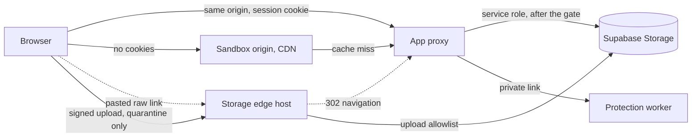
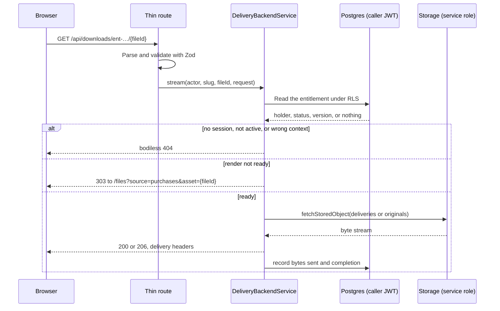
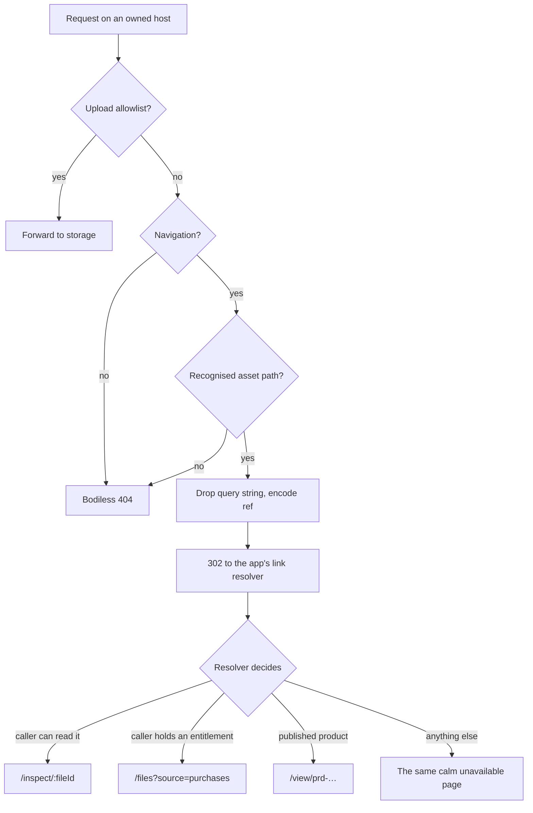

# Asset Storage, Delivery & Proxy Architecture

> **Proposed design. Nothing here is built, and it binds nothing until the rulings in §13 are
> made.** Logged as Decision #393. Companion spec: [`ANTI_PIRACY_ENGINE.md`](ANTI_PIRACY_ENGINE.md)
> (watermarking, leak detection, takedowns, AI resistance). Business rules: `PRODUCT_SPEC.md`
> §Digital Marketplace & IP Governance 7. Plan numbers: `finance-model.md` §16.8.
>
> Existing contracts stay where they live. This document links to
> [`database/files/Storage.md`](../database/files/Storage.md) instead of restating the proxy, and
> its schema is deliberately absent from `database/*`, which documents only what is migrated.

## 1. Assessment

**The goal is achievable, but "prevent saving" is not.** Anything a browser can render, an
authorised person can copy. No header, canvas or client-side cipher changes that. What this
architecture actually buys is four narrower guarantees:

1. A stranger can never reach an original.
2. A buyer receives a copy that traces back to their purchase.
3. A public preview is worth less than the product.
4. A leaked copy can be found and acted on by whoever holds the rights.

| Lens       | For                                                                                                                                                                 | Against                                                                                                                                                                                        |
| :--------- | :------------------------------------------------------------------------------------------------------------------------------------------------------------------ | :--------------------------------------------------------------------------------------------------------------------------------------------------------------------------------------------- |
| Technical  | The proxy, its header allowlist, the uniform 404 and the navigation redirect already exist (Decision #161).                                                         | A CDN, a sandbox origin, a render worker and a large-file upload path are all new, and no production edge has been chosen.                                                                     |
| Database   | Purely additive. Nothing touches `wallets`, `escrows` or `project_stages`.                                                                                          | The checkout definer `finance.place_wallet_order` is a money path, and it must write the entitlement.                                                                                          |
| Experience | A pasted raw link lands on a useful page, and a seller sees exactly what fingerprinting does before accepting it.                                                   | A large fingerprinted download is no longer instant, and previews lose fidelity, which can lower conversion.                                                                                   |
| Commercial | Seller trust is what the Asset Marketplace line sells. Leak monitoring gives Pro and Agency a reason to upgrade, and source bundles favour teams over one-off gigs. | Proxied egress and per-buyer rendering are per-sale costs against a commission as low as 6.5% (`finance-model.md` §1.2). Neither has been measured, so low-priced products may not cover them. |

**Recommendation.** Build it in the §14 order, beginning with the blocker in §2. Fingerprinting a
file nobody can download protects nothing.

## 2. Baseline (verified against the tree, 2026-11-06)

| Capability             | Today                                                                                                                                 | Source                                                            |
| :--------------------- | :------------------------------------------------------------------------------------------------------------------------------------ | :---------------------------------------------------------------- |
| Streaming read proxy   | **Built.** Gate, allowlisted headers, never `text/html`, sandbox CSP, bodiless 404.                                                   | `Storage.md` §The upload pipeline · `services/media/stream.ts`    |
| Navigation redirect    | **Built** on the proxy: a `303` to `/inspect/[fileId]`, with `?raw=1` or `?download=1` opting out.                                    | `features/inspector/core/proxy-navigation.ts`                     |
| Signed read URLs       | **Still reach browsers.** `/api/files/object/[id]` answers `302` to a 300-second URL, and the library picker reads signed thumbnails. | `services/files/live-objects.ts` · `core/storage-signed.ts`       |
| Signed upload URLs     | **Reach browsers by design**: a write capability on one `quarantine` object.                                                          | `core/storage-signed.ts`                                          |
| Public buckets         | **Four**: `avatars`, `showcase`, `catalogue`, `public_assets`. SSR links them directly.                                               | `00005040_seed_storage_buckets.sql` · `core/storage-url.ts`       |
| Object ceiling         | **50 MiB** globally, with ClamAV contracted to 64 MiB.                                                                                | `supabase/config.toml` · `Projective-Safety/clamav/clamd.conf`    |
| Malware scan           | **Not built.** `scanning` is a magic-byte sniff.                                                                                      | `Storage.md` §Deferred                                            |
| Elevation on attach    | **Specified, not built.** `PRODUCT_SPEC.md` says a file attached to a product becomes Public.                                         | `PRODUCT_SPEC.md` §Privacy scopes · `projects/live-files.ts` note |
| CDN and sandbox origin | **Neither exists.** No CDN sits in front of the proxy.                                                                                | `Storage.md` §Deferred · EPI §9.2                                 |
| Buyer delivery         | **Does not work.** See below.                                                                                                         | below                                                             |

### The blocker: a buyer cannot receive a purchased file today

- `finance.place_wallet_order` inserts each product line without `asset_id`
  (`00001210_functions_finance_kyc_wallet.sql:1892`), no other path writes that column, and
  `services/finance/live-orders.ts:342` offers a download only when it is set.
- The same insert reads `manifest -> 0`, so a bundle of up to 24 files keeps only its first entry's
  name and size.
- Setting `asset_id` would not be enough. The link is `/files?asset=…`, and `files.fn_can_read` has
  no purchase arm, so a buyer cannot read a seller's private file.
- No page lists what a person has bought. `AssetSource` has no purchases value.

`flows/CATALOGUE_REBUILD.md` logged this as an open gap under Decision #217(i). Everything below
assumes §10 closes it.

## 3. Invariants

Each is written to be testable, and §14 names the check.

1. **No public object store.** Every bucket is `public = false`, and no `storage.objects` policy
   grants `SELECT` to `anon` or `public`.
2. **No storage address in a read.** No response carries a storage host, bucket, object path or
   signed read URL.
3. **Gate first, key second.** The entitlement decision runs in the caller's JWT context. The
   service role only moves bytes, afterwards (root `CLAUDE.md` §6).
4. **One refusal.** Every refusal on a protected route is the same bodiless `404`, plus `429` and
   `503`, so a route cannot be used to learn that a file exists.
5. **A preview is a derivative.** Nobody who has not bought a product receives its original or any
   prefix of it. Protection comes from what the bytes are, never from how the page draws them.
6. **Uploader bytes are hostile.** They are never `text/html`, never executed on the app origin, and
   anything active is served sandboxed.
7. **A redirect is courtesy, not access control.** `Sec-Fetch-Dest` can be forged. Security rests on
   invariants 1 to 3.

## 4. Storage isolation

### 4.1 Target bucket matrix

| Bucket                                                                                                     | Today   | Target                                         | Read door             |
| :--------------------------------------------------------------------------------------------------------- | :------ | :--------------------------------------------- | :-------------------- |
| `quarantine` · `project` · `messages` · `personal` · `workspace` · `invoices` · `verification` · `contact` | Private | Unchanged                                      | Unchanged             |
| `avatars` · `showcase` · `catalogue` · `public_assets`                                                     | Public  | **Private** (§4.2)                             | Public plane (§5.2)   |
| **`originals`** (new)                                                                                      | n/a     | Private, no policy at all, like `verification` | Entitlement gate (§6) |
| **`deliveries`** (new)                                                                                     | n/a     | Private, no policy at all; objects are swept   | Entitlement gate (§6) |

```text
originals/{product_id}/{version_id}/{file_id}/{name}     sale originals, immutable once published
deliveries/{entitlement_id}/{delivery_id}/{name}         per-buyer copies, seven-day TTL
```

**Why new buckets instead of `personal` and `workspace`.** Both grant their owner or any active
member a read, and a seller's own library is where drafts live. A bucket with no policy means no JWT
can reach a sale original through any path, including a compromised seller session. Every path gets
a builder in `@projective/types/files` (`Storage.md` §Path builders), and `BUCKETS` mirrors the
seed.

**Sale originals are snapshots** (ruling A6). A published version is frozen, so a seller who
renames, replaces or deletes a library file cannot change what a buyer already paid for. This is a
deliberate exception to "one asset, never copied" (`PRODUCT_SPEC.md` §Assets & Attachments), and to
automatic elevation: a sale original is never `link` or `public`, whatever it is attached to.

### 4.2 Making a public bucket private takes three changes, in this order

1. **Move every reader first.** `publicObjectUrl()`, `objectUrlOf()` and `parsePublicObjectUrl()` in
   `core/storage-url.ts` feed SSR, cards, `og:image`, mail and `org.get_party_cards`. Flipping a
   bucket first breaks every image on the platform.
2. **Delete the four `SELECT … TO public` policies** in `00002017_policies_storage.sql`. The flag
   alone is not enough. Measured locally on 2026-11-06,
   `GET /storage/v1/object/authenticated/avatars/…` with nothing but the publishable anon key
   answered `200`, and the same call for a private `project` object was refused. `public = false`
   closes the `/object/public/` route only, so a surviving policy leaves every object readable by
   anyone who has that key.
3. **Flip each hosted project.** `00005040` inserts with `ON CONFLICT (id) DO NOTHING`, so editing
   the seed in place changes a fresh `db reset` and nothing on a running project. It needs either a
   deployment-time `UPDATE storage.buckets` or a seed that is
   `DO UPDATE SET public = EXCLUDED.public`.

### 4.3 What can and cannot be intercepted

| Host                                             | Who controls it | Behaviour                                                                                                                                     |
| :----------------------------------------------- | :-------------- | :-------------------------------------------------------------------------------------------------------------------------------------------- |
| `storage.<domain>`, set as `SUPABASE_PUBLIC_URL` | Projective      | The edge rules in §7.                                                                                                                         |
| `{ASSET_SANDBOX_ORIGIN}`                         | Projective      | The public plane in §5.2.                                                                                                                     |
| `<ref>.supabase.co`                              | Supabase        | **Cannot be intercepted.** Supabase's docs say that after a custom domain "the Supabase project domain continues to work and serve requests". |

On that last host a private object answers storage's own error. Locally that is a `400` carrying
`{"statusCode":"404","error":"Bucket not found",…}`. So the brief's "no raw 403 JSON" holds on hosts
Projective owns and cannot hold on Supabase's.

Two consequences:

- **Do not rely on the host being secret.** A seller's signed upload names it. Safety comes from
  invariant 1, and the JSON error reveals nothing.
- **`SUPABASE_PUBLIC_URL` must name the edge host before the first production URL is emitted.**
  `publicise()` and `publicObjectUrl()` build every browser-facing address from it, so a URL
  published on `*.supabase.co` can never be recaptured later.

The edge host needs no Supabase custom domain. It is a worker of ours that forwards a short
allowlist to the project origin, the shape `scripts/share.ts` already proves with its storage-only
proxy (`SYSTEM_ARCHITECTURE.md` §Environment Variable Contract). Supabase's docs do not cover a
proxy in front of a custom domain, so that route is avoided.

## 5. Delivery planes

### 5.1 Overview



The two planes exist because their requirements conflict. Protected bytes need the session cookie,
so they must stay on the app origin. Public derivatives need global caching and must never sit
beside that cookie.

### 5.2 Public plane

**Serves:** avatars, showcase media, listing covers and every preview derivative. Each is a
pipeline-cut rendition, moderated by the publication gate (Decision #148) and worthless as a source.

- **Address:** `{ASSET_SANDBOX_ORIGIN}/p/{variantId}.{ext}`, a separate registrable domain with no
  cookies and no session.
- **Origin pull:** `GET /api/media/public/[variantId]` on the app. The CDN holds no storage
  credential, and the app stays the only holder of the service key.
- **Why it can be cached forever:** a rendition's path changes whenever its bytes do, the rule
  `uploadObject(…, { immutable: true })` already follows.
- **Why this satisfies the brief without a token:** the sandbox cannot see a session, so a private
  file there would need a token in the URL, which is a signed URL by another name. Keeping entitled
  bytes off this plane removes the problem. Nothing here needs authorisation.

### 5.3 Protected plane

**Serves:** everything needing a session. That means the existing collaboration reads through
`/api/media/proxy/[fileId]`, plus entitled previews and deliveries through the new
`/api/downloads/*` routes (§6).

`/api/media/proxy/[fileId]` is not renamed, and no `/api/assets/:id` duplicate is added. It gains
one refusal: `originals` and `deliveries` are never served through it, so `fn_can_read` can never
become a second door to a sale original.

**Retired:** `/api/files/object/[id]` and `signedReadUrls()`. Their two remaining consumers (the
library picker and the share-folder listing) move to the proxy, which closes the last signed read
URL reaching a browser. **Kept:** signed upload URLs (ruling A2). They write one `quarantine` object
and read nothing, and routing uploads through the app would hold a request worker for an entire
multi-gigabyte body.

### 5.4 Response header matrix

| Delivery class                  | Cache-Control                                         | Content-Disposition                   | CORP           | CSP                           |
| :------------------------------ | :---------------------------------------------------- | :------------------------------------ | :------------- | :---------------------------- |
| `public-derivative`             | `public, max-age=31536000, immutable`                 | `attachment`                          | `cross-origin` | `default-src 'none'; sandbox` |
| `collaboration` (today's proxy) | `private, no-transform, max-age=3600` (**unchanged**) | `inlineSafe()` decides, as today      | `same-origin`  | Sandbox when not inline-safe  |
| `share` (today's proxy)         | `private, no-store` (unchanged)                       | `inlineSafe()` decides, as today      | `same-origin`  | Sandbox when not inline-safe  |
| `entitled-preview`              | `private, no-store`                                   | `inline`                              | `same-origin`  | Sandbox when not inline-safe  |
| `delivery`                      | `private, no-store`                                   | `attachment` (display name, RFC 5987) | `same-origin`  | `default-src 'none'; sandbox` |

Every class also carries `x-content-type-options: nosniff`, and `proxyContentType()` applies as it
does today: never `text/html`. Protected classes keep `x-robots-tag: noindex, nofollow`,
`referrer-policy: no-referrer` and `vary: cookie, sec-fetch-dest`. `proxyHeaders()` gains one option
for the two new classes. Nothing else about it changes.

Three deliberate differences from the brief:

- **`no-store` covers marketplace bytes, not everything** (ruling A3). Since Decision #162 every
  `/files` grid thumbnail is a proxied read, each holding a request worker and spending the
  1,200-a-minute window. Applying `no-store` there would re-stream every thumbnail on every visit to
  protect files that are not for sale.
- **`public-derivative` is `cross-origin`** (ruling A4). `same-origin` on the sandbox would stop the
  app itself from embedding the image, which defeats the plane.
- **`attachment` on a public image does not stop ``.** Browsers ignore it on subresources. It
  is a backstop for a navigation, which the edge redirects first anyway.

### 5.5 What these headers do not do

`no-store` keeps a file out of the browser's disk cache and nothing more. It does not stop DevTools,
Save As on a rendered canvas, a screenshot or a capture card. Copy shown to sellers must say
"traceable and deterred", never "cannot be copied".

## 6. Protected request pipeline



| # | Gate | Check | On failure | | : | :------------------- |
:--------------------------------------------------------------------------------------------------------------------------
| :------------------------------------------------- | | 1 | Shape | Zod on the `ent-…` slug and
file id. | `404` | | 2 | Hotlink | `Sec-Fetch-Site: cross-site` with a `Sec-Fetch-Dest` other than
`document` is refused, so no bytes are spent. | `404` | | 3 | Authentication | `readActor(ctx)`
holds a live session. | A navigation goes to `/login?redirectTo=`, otherwise `404` | | 4 | Session
context | The acting context matches the holder: the person, or a member of the buying business
holding `purchase` (Decision #237). | `404` | | 5 | Entitlement | A row is readable under the
caller's own JWT and `status = 'active'`. | `404` | | 6 | Manifest | The file belongs to a version
the entitlement covers. | `404` | | 7 | Rate | A daily ceiling per entitlement, then the existing
identity window. Only a fresh read spends it (`countsTowardLimit`). | `429` with `retry-after` | | 8
| Readiness | The delivery row is `ready`, or the profile is `disabled`. | `303` to the purchases
view while it renders | | 9 | Transport | `fetchStoredObject`, with `Range` and conditional headers
forwarded and the abort signal wired. | `503` if storage is unreachable |

**Reuse.** `fetchStoredObject`, `upstreamOutcome`, `forwardHeaders`, `contentDisposition` and
`countsTowardLimit` are used as they stand. The new service owns gates 3 to 8 only.

**Delivery evidence.** The refund rule depends on whether a file was delivered, so the stream
records `bytes_sent` and sets `completed_at` when the body finishes. `first_delivered_at` is stamped
once (ruling A8).

**Worker cost.** A streamed download holds a request worker for its whole length (`Storage.md`
§Deferred). The scale-out path keeps the gate in the app and moves the bytes to the edge in the
`X-Accel-Redirect` style: the app authorises, then instructs the edge to stream, and the browser
still never sees a storage address. Build this only once measurement demands it.

## 7. Direct-link interception

The behaviour is written for any edge: a Cloudflare Worker, Caddy or another reverse proxy. It runs
on the two hosts Projective controls (§4.3). It is stateless and holds no secret and no database
access, so a compromise exposes no credential and no private byte, though it could misdirect
traffic.

### 7.1 Decision table

Evaluated in order. "Navigation" is the predicate `inspectRedirect` already uses, so app and edge
cannot disagree: `Sec-Fetch-Dest: document`, or, for a browser without Fetch Metadata, an `Accept`
header beginning `text/html`.

| # | Request | Answer | | : |
:----------------------------------------------------------------------------------------------------------------
|
:----------------------------------------------------------------------------------------------------------------
| | 1 | Upload allowlist: `/storage/v1/object/upload/sign/quarantine/*` and
`/storage/v1/upload/resumable*` | Forward to the project origin. Strip nothing the signed upload
needs, and answer CORS for `{APP_ORIGIN}` only. | | 2 | Navigation to
`/storage/v1/object/{public,authenticated,sign,info}/{bucket}/{path…}` | `302` to
`{APP_ORIGIN}/api/assets/link?ref={ref}`. | | 3 | Navigation to
`{ASSET_SANDBOX_ORIGIN}/p/{variantId}.{ext}` | `302` to
`{APP_ORIGIN}/api/assets/link?variant={variantId}`. | | 4 | Public read during migration only: a
subresource read of `/object/public/{bucket}/…` for the four public buckets | Forward. **Delete this
row when §4.2 completes.** | | 5 | Anything else on the storage host | Bodiless `404`,
`cache-control: no-store`. No storage JSON ever reaches a client on this host. |

Every `302` carries `cache-control: no-store` and `vary: sec-fetch-dest, accept`, so a cached image
can never answer a navigation, and the reverse.



### 7.2 Extracting the reference

- `ref` is the base64url of `{bucket}/{path}`, taken from the URL path only.
- **The query string is dropped before the redirect.** A signed URL's `token` is a credential, and
  forwarding it would copy that credential into the app's logs and the browser's history. The edge
  must not log it either.
- The edge cannot resolve an id itself. Only some paths contain one, for instance
  `personal/users/{user}/library/{asset_id}/…`, whereas `avatars/{entity}/avatar/{rendition}/…` does
  not. Resolving needs the database, so that step belongs to the app.

### 7.3 The resolver: `GET /api/assets/link`

`ref` is untrusted input, used only as a lookup key on `files.items (bucket_id, storage_path)` or
`files.item_variants`, and never as a path to read. It answers `303` (the app's existing convention
for this redirect, equivalent to the `302` for a GET).

| Finding                                                                | Target                                           |
| :--------------------------------------------------------------------- | :----------------------------------------------- |
| The caller may read the file (`fn_can_read`, in their own JWT context) | `/inspect/{fileId}`                              |
| The caller holds an active entitlement to it                           | `/files?source=purchases&asset={fileId}`         |
| It belongs to a product on a published listing                         | `/view/prd-…`, the purchase page                 |
| Anything else, including no such object                                | The inspector's "This file isn't available" page |

The last row is deliberately one answer: a private file the caller cannot read and an object that
never existed must look identical (`PRODUCT_SPEC.md` §The File Inspector). The route is rate-limited
per client, `noindex`, and lives under `/api/` so it cannot collide with the `[handle]` namespace.

A person who opens a preview in a new tab therefore lands on the purchase page, turning a dead end
into a conversion path.

### 7.4 Client addresses

Once a proxy fronts the app, every caller's socket peer is that proxy. The per-IP limits then
collapse into one bucket unless the proxy's client-address header is wired into `clientKey()`
(`SYSTEM_ARCHITECTURE.md` §Runtime & API Security, Decision #296 (F)). That wiring is part of this
change, not an afterthought, or the auth throttles degrade silently.

## 8. Upload safety

### 8.1 Scope

These rules apply to **sale originals and anything headed for the public plane**. Collaboration
uploads keep today's rule: hostile bytes are refused and nothing else is, because the creative safe
harbour and the range of formats a brief may require are intended (Decision #148). A whitelist on
`project` or `messages` would break legitimate work.

### 8.2 Pipeline

This extends the five steps in `Storage.md` §The upload pipeline, and adds the bold ones.

1. **Declare**, with a new `purpose = 'sale_original'`.
2. **Upload** to `quarantine`. Files above the existing limit use resumable TUS (§8.4).
3. **Claim and sniff**, by magic bytes, never the declared type or extension.
4. **Whitelist** (§8.3). Bucket `allowed_mime_types` only checks what the client declared, so this
   check runs in the service against sniffed bytes.
5. **Inspect archives** (§8.3).
6. **Malware scan**, failing closed: `503`, and the row returns to `pending_upload` (EPI §6.4). For
   a sale original the scan is mandatory, so `MALWARE_SCAN_LIVE` must be on before listings open.
7. **Admit** to the seller's library at `status = 'uploaded'`.
8. **Publish:** snapshot into `originals`, cut the preview derivatives, run them through the
   publication gate, compute signatures (`ANTI_PIRACY_ENGINE.md` §7.3).

### 8.3 Sale-original whitelist

Keyed on the existing `FileCategory` taxonomy, so classification and policy cannot fork.

| Category      | Admitted                                             | Extra rule                                                                                                          |
| :------------ | :--------------------------------------------------- | :------------------------------------------------------------------------------------------------------------------ |
| Image, Vector | PNG, JPEG, WebP, AVIF, TIFF, HEIC, PSD, AI, EPS, SVG | SVG is sold as a download. Its preview is always rasterised.                                                        |
| Document      | PDF, EPUB, DOCX, XLSX, PPTX                          | Macros are refused (Decision #340, ruling T5). Encrypted PDFs are refused: they can be neither scanned nor stamped. |
| Audio         | WAV, FLAC, AIFF, MP3, OGG, M4A                       | None                                                                                                                |
| Video         | MP4, MOV, WebM, MKV                                  | None                                                                                                                |
| 3D, CAD       | GLB, glTF, OBJ, FBX, STL, BLEND, USDZ, 3MF, STEP     | None                                                                                                                |
| Font          | OTF, TTF, WOFF2                                      | None                                                                                                                |
| Code, Archive | ZIP, TAR, TAR.GZ                                     | Archive rules below. Scripts are expected inside a code kit, so a script alone is not a refusal.                    |
| Anything else | Refused, with a message naming the format            | A new format is added here, deliberately.                                                                           |

**Archive rules:** every member is sniffed and scanned, password-protected archives are refused
because they cannot be scanned, and path traversal, symlinks, device files, excessive nesting and
extreme expansion ratios are refused. Clamd's `MaxScanSize` and `MaxRecursion` already bound part of
this (EPI §6.4).

### 8.4 File size

The brief's gigapixel, 3D and video cases cannot be uploaded today. Sale originals need a higher
ceiling, and several things must move together.

| Constraint               | Today                                  | Needed                                                                                                                                                                                           |
| :----------------------- | :------------------------------------- | :----------------------------------------------------------------------------------------------------------------------------------------------------------------------------------------------- |
| Storage global limit     | 50 MiB (`config.toml`)                 | A hosted setting. Supabase documents up to 500 GB on Pro and above, though one of its troubleshooting pages still says 50 GB, so test it.                                                        |
| `originals` bucket limit | n/a                                    | **Proposed 2 GiB** (ruling A7), and it cannot exceed the global limit.                                                                                                                           |
| Upload transport         | Standard signed `PUT`                  | Resumable TUS. Supabase recommends it above 6 MB, requires 6 MB chunks, and accepts a signed upload token in `x-signature`. Confirm that this works with no user JWT, because islands hold none. |
| ClamAV                   | `StreamMaxLength 64M`, 60-second route | A large-file scan route on the safety node, with tmpfs sized for it. Confirm the real limit against the pinned image; its manual caps size options at 4 GB.                                      |
| In-memory reads          | `downloadObject()` buffers the object  | Large objects must stream. The Worker decode step cannot hold them.                                                                                                                              |

### 8.5 Sandbox origin rules

`{ASSET_SANDBOX_ORIGIN}` is a separate registrable domain, not a subdomain, so it can never receive
an app cookie or share a site with the app. It carries HSTS, sets no cookies, serves only the §5.4
`public-derivative` headers, and allows `Access-Control-Allow-Origin: {APP_ORIGIN}` so a canvas can
read a preview. `apps/web/utils/csp.ts` adds the origin to `img-src`, `media-src` and `connect-src`.
Its broad `https:` source in `img-src` and `media-src` can then be narrowed, as a separate
hardening.

Showcase video keeps its uploaded bytes today (`Storage.md` §`showcase`), so this origin is also
what makes that safe. It serves video without any path to the session.

## 9. Delivery strategy per format

The strategy is keyed on the file's `FileCategory`, because `catalogue.product_format` (`template`,
`bundle` and so on) describes the offer and not the media.

| Kind                 | Public preview (anyone)                                                               | Final delivery                     | Traceability                                  | What still leaks                      |
| :------------------- | :------------------------------------------------------------------------------------ | :--------------------------------- | :-------------------------------------------- | :------------------------------------ |
| Images, textures     | New `preview` tier: long edge ≤ 1600 px by default, overlay baked in, re-encoded WebP | Source format, per buyer           | Frequency-domain fingerprint                  | Regeneration by a generative model    |
| Gigapixel images     | Deep-zoom tiles up to a seller-set zoom cap                                           | Tiled, per buyer                   | Tile-level fingerprint, or none (engine §3.2) | Same                                  |
| PDF, EPUB, DOCX      | Server-rendered page images of seller-chosen pages                                    | Stamped per buyer                  | Margin stamp, metadata                        | Retyping or OCR                       |
| Code, developer kits | README, file tree, seller-chosen excerpts                                             | Scoped tarball or private registry | Per-buyer archive hash, signed licence file   | The source itself, once installed     |
| Audio                | Opus at 128 kbps, ≤ 30 s, audible tag                                                 | WAV, FLAC or stems                 | Spread-spectrum fingerprint                   | Re-recording                          |
| Video                | ≤ 720p, ≤ 30 s, moving burned-in mark                                                 | Master file                        | Segment A/B fingerprint                       | Screen capture at a lower quality     |
| 3D, CAD              | Decimated GLB (≤ 10% of faces), downsampled textures, no rig                          | Source file                        | Texture fingerprint; CAD gets none            | Retopology                            |
| Fonts                | Specimen rendered to images, never the font file                                      | OTF, TTF or WOFF2                  | Licence fields in the `name` table            | Fields are easily edited              |
| Layered source       | Flattened render                                                                      | PSD, AI, BLEND, stems              | Per-buyer archive hash only (engine §3.1)     | **Highest value and weakest marking** |

**Previews never use the inspector's canvases on an original.** Those canvases fetch the whole file
(`SYSTEM_ARCHITECTURE.md` §The file inspector and the streaming proxy), so a "preview" that way is a
free download. A preview is always a derivative written to `files.item_variants`.

### 9.1 Images and textures

The low-resolution derivative is the control. A canvas or `blob:` URL only adds friction against
right-click, because the Network panel still shows the bytes. It also costs server rendering, LCP
and accessibility. Use a canvas only for zoomable tiles, with `role="img"` and a real label, and
plain `` elsewhere. Uncompressed sources stay in `originals`.

### 9.2 PDFs and documents

- **Before purchase:** server-rendered page images, so the PDF never reaches the browser.
- **In-app reader for buyers:** the stamped copy is served as AES-GCM chunks under a short-lived
  session key, decrypted in a Web Worker and handed to the existing `pdfjs-dist` canvas.
  - **Be honest about this.** The key is necessarily in the same browser, so the cipher stops a
    casual copy from the Network panel and nothing more.
  - **The text layer stays.** Accessibility is a merge gate (root `CLAUDE.md` §3 rule 2), so an
    entitled reader keeps selectable text for screen readers, and text can therefore be extracted.
    Print and Download render only where the licence allows them, because a control that renders
    must do something (rule 11).
- **Final export:** `Licensed to {holder} · Order {ref} · {date}` in the page margin, plus XMP
  metadata, applied by the protection worker before the file is released.
- **Edge cases:** stamping invalidates a digital signature, so the seller is warned at publish.

### 9.3 Code and developer assets

Code has no perceptual tolerance, and per-buyer comments are stripped in seconds. So the control is
entitlement, not marking.

- **Scoped tarball:** a per-buyer archive containing `LICENCE.projective.json`, an Ed25519-signed
  statement of the product, version, licence type and order reference. Its hash is recorded, which
  proves an exact copy came from that delivery and nothing more.
- **Private registry:** an npm-protocol, read-only facade at `/api/registry/`, authenticated by a
  `pjt_` token scoped to one entitlement. The token is shown once and stored as a hash only, the
  same rule as guest links (Decision #391).
- **Verification gateway:** `POST /api/licences/verify` returns a signed, expiring statement. **It
  must fail open.** A buyer's production system must never stop because Projective is unreachable,
  so a kit treats a failed check as "unverified, continue" and uses the gateway only to entitle
  updates.

### 9.4 Audio, video and 3D

Audio and video previews need a transcode, and "the server never decodes video" today (`Storage.md`
step 4), so these derivatives run on the protection worker. A 3D preview is a decimated GLB with
downsampled textures and no rig or source. The existing `three` canvas renders it unchanged, and
compression such as Draco is not protection.

## 10. Data model (proposed, not migrated)

Everything lands by editing the consolidated files in place. `documentation/database/*` and the Zod
SSOT change only when this is actually migrated (root `CLAUDE.md` §1).

```sql
-- 00000004_enums_domains.sql, edited in place, not ALTER TYPE
-- files.asset_purpose  gains 'sale_original', 'delivery'
-- files.variant_tier   gains 'preview'
CREATE TYPE catalogue.entitlement_status AS ENUM ('active', 'refunded', 'revoked');
CREATE TYPE catalogue.delivery_status AS ENUM ('queued', 'rendering', 'ready', 'failed', 'expired');

-- 00000023_tables_catalogue.sql
-- A published, immutable bundle. file_manifest stays the seller's draft; this is what was sold.
CREATE TABLE catalogue.product_versions (
    id uuid PRIMARY KEY DEFAULT gen_random_uuid(),
    product_id uuid NOT NULL REFERENCES catalogue.products (id) ON DELETE CASCADE,
    version integer NOT NULL CHECK (version > 0),
    manifest jsonb NOT NULL,  -- [{ fileId, name, label, bytes, sha256, category }], at most 24
    published_at timestamptz NOT NULL DEFAULT now(),
    CONSTRAINT product_versions_number_key UNIQUE (product_id, version),
    CONSTRAINT ck_product_versions_manifest CHECK (
        jsonb_typeof(manifest) = 'array' AND jsonb_array_length(manifest) BETWEEN 1 AND 24
    )
);

-- One row per purchased line. SET NULL because a receipt outlives its product (ruling A11).
CREATE TABLE catalogue.entitlements (
    id uuid PRIMARY KEY DEFAULT gen_random_uuid(),
    slug text NOT NULL UNIQUE,  -- `ent-…`, minted by security.fn_slug_guard('ent') (Decision #88)
    order_line_id uuid NOT NULL UNIQUE REFERENCES finance.order_lines (id),
    product_id uuid REFERENCES catalogue.products (id) ON DELETE SET NULL,
    version_id uuid REFERENCES catalogue.product_versions (id) ON DELETE SET NULL,
    holder_type files.owner_kind NOT NULL,
    holder_id uuid NOT NULL,
    licence catalogue.product_licence NOT NULL,
    seats integer NOT NULL DEFAULT 1 CHECK (seats BETWEEN 1 AND 999),
    updates_until timestamptz,  -- NULL means every later version is covered
    status catalogue.entitlement_status NOT NULL DEFAULT 'active',
    first_delivered_at timestamptz,
    created_at timestamptz NOT NULL DEFAULT now(),
    updated_at timestamptz NOT NULL DEFAULT now(),
    CONSTRAINT ck_entitlements_slug_shape
        CHECK (slug ~ '^ent-[23456789abcdefghjkmnopqrstuvwxyz]{10}$')
);

-- One per entitlement and file, for ever: a re-render reuses the same token.
CREATE TABLE catalogue.deliveries (
    id uuid PRIMARY KEY DEFAULT gen_random_uuid(),
    entitlement_id uuid NOT NULL REFERENCES catalogue.entitlements (id) ON DELETE CASCADE,
    file_id uuid NOT NULL REFERENCES files.items (id),
    fingerprint_token bytea CHECK (octet_length(fingerprint_token) = 8),  -- NULL when disabled
    profile_revision integer,
    status catalogue.delivery_status NOT NULL DEFAULT 'queued',
    object_path text,  -- inside `deliveries`; never projected to a client
    delivered_unmarked boolean NOT NULL DEFAULT false,
    bytes_sent bigint NOT NULL DEFAULT 0 CHECK (bytes_sent >= 0),
    completed_at timestamptz,
    expires_at timestamptz,
    created_at timestamptz NOT NULL DEFAULT now(),
    updated_at timestamptz NOT NULL DEFAULT now(),
    CONSTRAINT deliveries_entitlement_file_key UNIQUE (entitlement_id, file_id)
);

-- Registry and licence tokens. Hash only: the token is shown once.
CREATE TABLE catalogue.licence_tokens (
    id uuid PRIMARY KEY DEFAULT gen_random_uuid(),
    entitlement_id uuid NOT NULL REFERENCES catalogue.entitlements (id) ON DELETE CASCADE,
    label text NOT NULL DEFAULT ''::text CHECK (char_length(label) <= 80),
    token_hash bytea NOT NULL UNIQUE CHECK (octet_length(token_hash) = 32),
    last_used_at timestamptz,
    revoked_at timestamptz,
    created_at timestamptz NOT NULL DEFAULT now()
);

-- 00004012_indexes_catalogue_marketplace.sql
CREATE UNIQUE INDEX ux_deliveries_file_token ON catalogue.deliveries (file_id, fingerprint_token)
    WHERE fingerprint_token IS NOT NULL;
CREATE INDEX ix_entitlements_holder ON catalogue.entitlements (holder_type, holder_id, status);

-- 00005040_seed_storage_buckets.sql: `originals` and `deliveries`, public = false, no policy.
```

| Table              | Client access                                                                  | Written by                                                    |
| :----------------- | :----------------------------------------------------------------------------- | :------------------------------------------------------------ |
| `product_versions` | Read: the owner. Buyers read through a service DTO.                            | The publish definer                                           |
| `entitlements`     | Read: the holder (`user`), or a member of the holding entity. No client write. | `finance.place_wallet_order`, the door every purchase reaches |
| `deliveries`       | **None.** It carries the token. Buyers see status through a service DTO.       | `SECURITY DEFINER` doors called by the service                |
| `licence_tokens`   | Read: the holder, without `token_hash`. Create and revoke through a service.   | The same doors                                                |

**Money path.** Every purchase reaches `finance.place_wallet_order`: it holds all the
`finance.order_lines` inserts, and `finance.place_on_account_order` calls it. So one definer writes
every entitlement, in the same transaction as its order line, and that change needs a concurrency
probe. A line refund sets `status = 'refunded'`. A delivered file cannot be recalled, so this only
closes future access.

**`file_manifest` stays.** It is the listing's editable draft and what the view page prints. A
version is what publish freezes.

**Reach.** Background work must write through definer doors. The service role has narrow grants
outside its own schemas, and fetch-faked tests hide a missing one, so verify these doors under
`SET ROLE` in `psql`.

## 11. API contracts

All routes are thin: HTTP parsing, Zod, then a fat service returning `ServiceResult<T>` (Decision
#10). Proposed routes are listed in `ROUTING.md` §Proposed: asset delivery and protection.

| Route                                                  | Methods        | Contract                                                                                                                            |
| :----------------------------------------------------- | :------------- | :---------------------------------------------------------------------------------------------------------------------------------- |
| `/api/media/public/[variantId]`                        | `GET` · `HEAD` | Origin for the public plane. Serves only a variant of a public file. `public-derivative` headers.                                   |
| `/api/assets/link`                                     | `GET`          | `?ref=` or `?variant=`. Always a `303` (§7.3). `no-store`, rate-limited.                                                            |
| `/api/downloads/[entitlement]/[fileId]`                | `GET` · `HEAD` | §6. `200` · `206` · `304` · `303` while rendering · `404` · `416` · `429` · `503`.                                                  |
| `/api/downloads/[entitlement]/[fileId]/status`         | `GET`          | `{ status, progress, etaSeconds }`, from the delivery row. `no-store`.                                                              |
| `/api/reader/[entitlement]/[fileId]/session`           | `POST`         | Opens a reader session: `{ sessionId, key, chunks, expiresAt }`. Counts as delivery (ruling A8).                                    |
| `/api/reader/[entitlement]/[fileId]/chunks/[n]`        | `GET`          | One encrypted chunk. `entitled-preview` headers.                                                                                    |
| `/api/entitlements/[entitlement]/tokens`               | `GET` · `POST` | List without hashes. Create and show once.                                                                                          |
| `/api/entitlements/[entitlement]/tokens/[id]`          | `DELETE`       | Revoke.                                                                                                                             |
| `/api/registry/[...path]`                              | `GET`          | npm-protocol packument and tarball. `Authorization: Bearer pjt_…`. Read-only. Every refusal is `404`.                               |
| `/api/licences/verify`                                 | `POST`         | `{ token, product, version }` → `{ valid, statement, expiresAt }`. Rate-limited per token. Reveals nothing about any other product. |
| `/api/catalogue/files/upload-init` · `upload-complete` | `POST`         | §8.2 steps 1 to 7, with `?team=` as elsewhere under `/api/catalogue/*`.                                                             |
| `/api/media/proxy/[fileId]`                            | `GET` · `HEAD` | **Changed:** refuses `originals` and `deliveries`.                                                                                  |
| `/api/files/object/[id]`                               | `GET`          | **Retired** once its consumers move (§5.3).                                                                                         |

```ts
/** One delivery request, as the thin route parsed it. Reuses the proxy's transport fields. */
export type DeliveryRequest = Omit<StreamRequest, "tier" | "share">;

/** Answered instead of bytes while a fingerprinted copy renders. */
export interface DeliveryPending {
	status: "queued" | "rendering";
	etaSeconds: number | null;
}

export const DeliveryBackendService: {
	stream(
		actor: ReadActor,
		entitlementSlug: string,
		fileId: string,
		request: DeliveryRequest,
	): Promise<ServiceResult<StreamedAsset | DeliveryPending>>;
};
```

## 12. Configuration

| Key                                | Where                      | Purpose                                                             | Starting value |
| :--------------------------------- | :------------------------- | :------------------------------------------------------------------ | :------------- |
| `ASSET_SANDBOX_ORIGIN`             | Env, **Proposed**          | The public plane's origin. Unset in development: the app serves it. | Unset          |
| `SUPABASE_PUBLIC_URL`              | Env, existing              | Must name the edge host before launch (§4.3).                       | n/a            |
| `PROTECTION_BACKEND_LIVE`          | Env, **Proposed**          | Gates rendering and monitoring, like the other `*_BACKEND_LIVE`.    | `false`        |
| `PROTECTION_WORKER_URL` · `_TOKEN` | Env, **Proposed**          | Private link to the protection worker.                              | Unset          |
| `delivery_daily_limit`             | `security.platform_params` | Fresh downloads per entitlement per day.                            | 20             |
| `delivery_ttl_hours`               | `security.platform_params` | Life of a rendered copy.                                            | 168            |
| `preview_max_long_edge_px`         | `security.platform_params` | Default for the `preview` tier.                                     | 1600           |
| `sale_original_max_mib`            | `security.platform_params` | Upload ceiling for sale originals.                                  | 2048           |

**Dev Context Switcher (root `CLAUDE.md` §5).** The build adds controls in the same change:
`pj.dev.delivery` (`auto` · `ready` · `rendering` · `failed`) and `pj.dev.entitlement` (`auto` ·
`active` · `refunded` · `none`), each through `DevOverrides`, `DEV_DEFAULTS`, a `DevOption` list, a
`DevContextPanel` control, and `reflect()` set and delete.

## 13. Rulings needed

These are logged in Decision #393. "Owner" means a product decision, and ⚖️ means counsel is needed.
The recommended answer is what this document assumes.

| #   | Question                                                                                                                                                                  | Recommendation                                                                                                      | Who      |
| :-- | :------------------------------------------------------------------------------------------------------------------------------------------------------------------------ | :------------------------------------------------------------------------------------------------------------------ | :------- |
| A1  | Do all four public buckets go private? `Storage.md` flagged this for a human, and the brief says yes.                                                                     | Yes, after the public plane exists (§4.2). Accepts a CDN as a hard dependency.                                      | Owner    |
| A2  | Does "no signed URLs" include uploads?                                                                                                                                    | No. The rule covers reads. Signed upload URLs stay, write-only, on `quarantine`.                                    | Owner    |
| A3  | Does `no-store` apply to all proxied bytes?                                                                                                                               | No. Marketplace bytes only (§5.4).                                                                                  | Owner    |
| A4  | Does the sandbox serve entitled files?                                                                                                                                    | No. Public derivatives only, so no token is ever needed. CORP is `cross-origin` there.                              | Owner    |
| A5  | Accept that `<ref>.supabase.co` cannot be intercepted?                                                                                                                    | Yes. Nothing is emitted on it, and private objects stay refused.                                                    | Owner    |
| A6  | Sale originals as a third zone: exempt from auto-elevation, and snapshotted, not shared?                                                                                  | Yes. Both amend `PRODUCT_SPEC.md` §Assets & Attachments.                                                            | Owner    |
| A7  | Upload ceiling for sale originals?                                                                                                                                        | 2 GiB, subject to the checks in §8.4.                                                                               | Owner    |
| A8  | What counts as "downloaded" for the refund rule? `PRODUCT_SPEC.md` says viewing is not downloading, so a whole PDF could be read in the reader and then refunded.         | First completed delivery, **or** opening an entitled reader session. Buyers must expressly accept this at checkout. | Owner ⚖️ |
| A9  | Is the "instant delivery" promise kept when a large file must render?                                                                                                     | Reword it: instant access, with large files prepared in minutes. Failure policy in the engine spec §6.              | Owner    |
| A10 | Are sale originals screened by the content classifier? Decision #148 has two zones, and a listing could pair a clean cover with a prohibited file.                        | Malware and whitelist always. Classifier on previews, and on originals only if the owner rules so.                  | Owner ⚖️ |
| A11 | How long may a buyer re-download, and what happens when a seller erases their account? `finance-model.md` §17 erases files with the account, while a licence outlives it. | Keep `originals` while any active entitlement exists, with a stated re-download window.                             | Owner ⚖️ |

## 14. Build order and verification

| Phase | Delivers                                                                        | Depends on                 | Done when                                                                                                                                      |
| :---- | :------------------------------------------------------------------------------ | :------------------------- | :--------------------------------------------------------------------------------------------------------------------------------------------- |
| 0     | Entitlements, `product_versions`, `originals`, `/api/downloads`, purchases view | A6, A8                     | A real checkout delivers every file of a bundle. A refunded line answers `404`. A concurrency probe passes on `place_wallet_order`.            |
| 1     | Close signed reads, retire `/api/files/object`                                  | A2                         | A test finds no storage host in any read response.                                                                                             |
| 2     | Upload whitelist, mandatory ClamAV, large files                                 | Safety node, A7            | EICAR is refused. A disallowed format is refused by sniffed type. A 1 GiB upload resumes.                                                      |
| 3     | Edge host, `SUPABASE_PUBLIC_URL`, direct-link resolver, `clientKey` wiring      | Edge choice, A5            | Every row of §7.1 has a test. A signed URL's `token` never appears in a redirect.                                                              |
| 4     | Sandbox origin, CDN, previews, then the §4.2 migration                          | A1, A4, phase 3            | A probe proves no `storage.objects` policy reaches `anon`, and `GET /object/authenticated/…` with the anon key is refused on all four buckets. |
| 5     | Fingerprinting, by format                                                       | Engine rulings             | `ANTI_PIRACY_ENGINE.md` §14.                                                                                                                   |
| 6     | Registry and licence gateway                                                    | Phase 0                    | A revoked token gets `404`. An unreachable gateway leaves a kit working.                                                                       |
| 7     | Leak monitoring and takedown packs                                              | Engine rulings, plan gates | `ANTI_PIRACY_ENGINE.md` §14.                                                                                                                   |

Phases 1, 2 and 6 can run in parallel once phase 0 lands. Each SQL change passes
`deno task test:probes:fresh`, and each new invariant ships its probe (`pr-checklist.md`).

**Not covered here:** hotlink blocking on the public plane, multi-region storage, and storage
backups (EPI §9.2 already flags that database recovery does not cover Storage objects, which now
matters far more, because `originals` holds what buyers paid for).

## Sources

External facts were checked on 2026-11-06. Re-check them at build, because these pages change.

- [Supabase: Custom Domains](https://supabase.com/docs/guides/platform/custom-domains): the project
  domain stays live, and the page does not cover proxies.
- [Supabase: Storage upload limits](https://supabase.com/docs/guides/storage/uploads/file-limits),
  [Standard uploads](https://supabase.com/docs/guides/storage/uploads/standard-uploads) and the
  [conflicting troubleshooting page](https://supabase.com/docs/guides/troubleshooting/upload-file-size-restrictions-Y4wQLT).
- [Supabase: Resumable uploads](https://supabase.com/docs/guides/storage/uploads/resumable-uploads):
  the 6 MB chunk and `x-signature`.
- [clamd.conf manual](https://linux.die.net/man/5/clamd.conf): an older copy, so confirm the limits
  on the pinned image.
